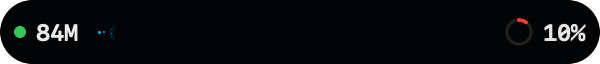
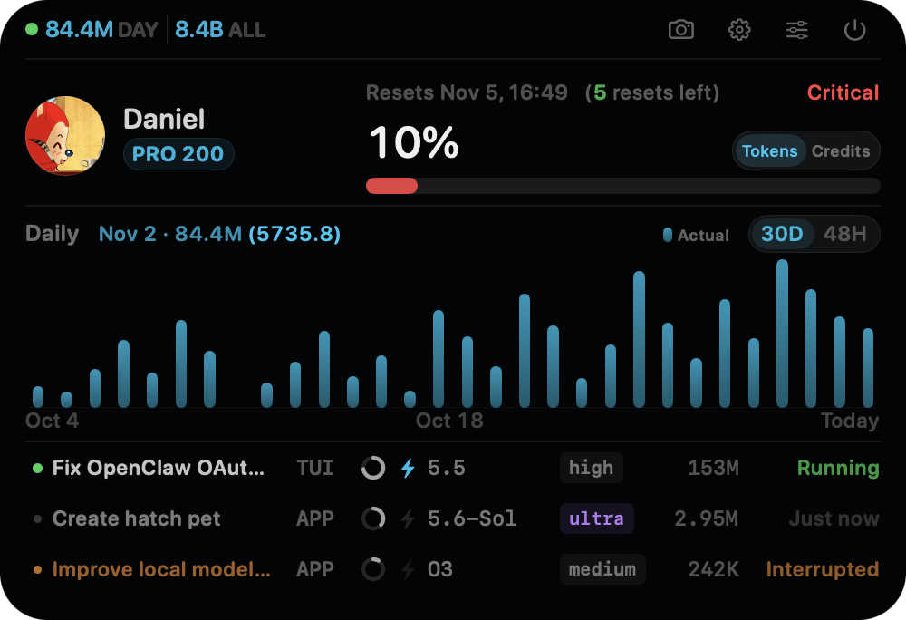
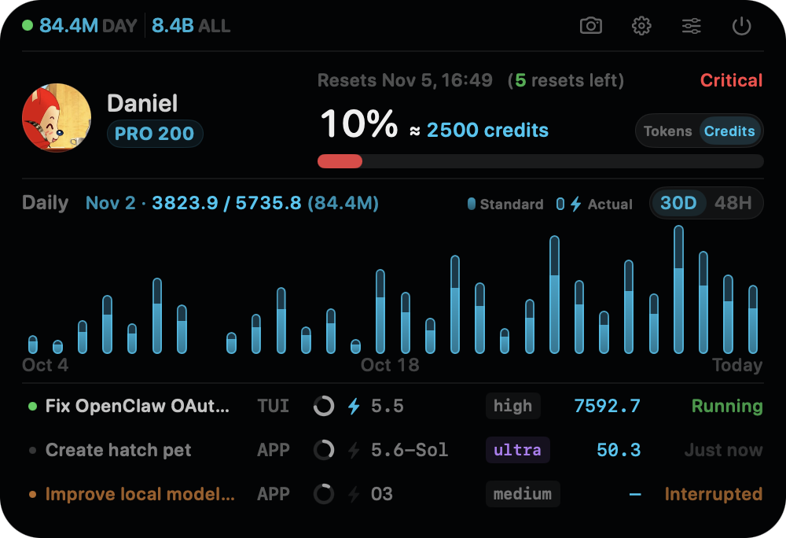
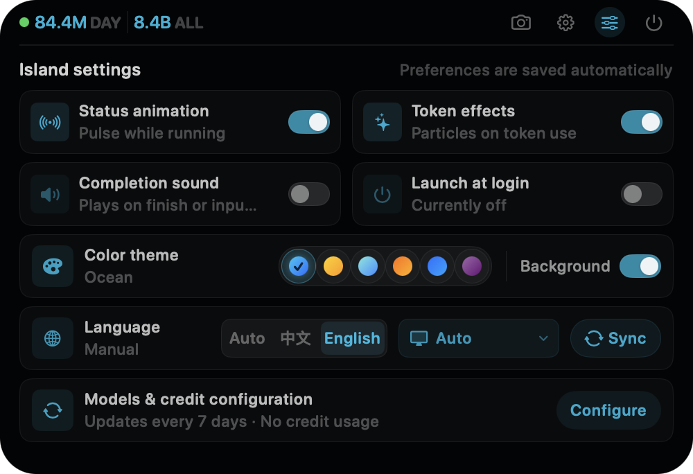

# Codex Island

**English** | [简体中文](README.zh-CN.md)

Codex Island is a floating status island for the top of macOS. It stays compact by default and expands on hover to show Codex account limits, profile identity, lifetime and recent token activity, actual token usage and credit costs, plus the source, compact model name, reasoning effort, Fast state, and cumulative token usage of the three most recent threads.

Account details, usage, and the thread index come from read-only endpoints exposed by the local `codex app-server`. Per-thread configuration comes from the latest `thread_settings_applied` event in that thread's local rollout. The profile name and avatar are fetched on demand from the Profile endpoint used by the Codex App; the authentication token is retained only in memory for the duration of the request and is never written to disk or logs. Codex Island does not parse message bodies or call endpoints that consume reset credits.

## Automatic model and credit configuration

Open **Models & credit configuration → Configure** in island settings. The app reads the official credit-rate page and the local Codex `model/list` catalog without calling a model or consuming credits. Automatic updates default to every **7 days**, adjustable from 1 to 365 days, with an **Update now** action. Due checks run once a minute, at launch, and after wake while the app is running; failures retain valid data and retry after one hour.

The writable configuration is `~/Library/Application Support/CodexIsland/CodexConfiguration.json`. It stores model capabilities, token rates, Fast multipliers, project subscription estimates, update timestamps, and the interval. Updates are validated and written atomically, then applied to credit calculations without restarting. Pricing and catalog updates can succeed independently. The model list only shows entries from the signed-in account’s Codex catalog; Fast rows also require an advertised Fast/priority tier. Pricing-page entries alone never establish model availability. Previously imported entries outside both the observed Codex model IDs and bundled historical reference models are removed on upgrade; user subscription estimates and the interval are preserved. The bundled JSON is a first-run fallback; invalid downloaded data does not replace valid prices. Retired models retain their dated reference rates for historical logs. Unknown rates remain unavailable.

Subscription allowance estimates are project reference values, not official account balances. Click the Plus amount in the settings allowance card to edit the baseline (default 1250) in a popover with a live Pro allowance preview, then click Save or press Return to apply and persist the change immediately without restarting. Alternatively, quit the app, edit `subscriptionEstimates.plus.credits`, and reopen it. `subscriptionMultipliers` defines Pro 100 / 200 / 500 as 10 / 20 / 50 times Plus; Pro allowances are derived rather than stored separately. Upgrading an old configuration preserves a custom Plus baseline and migrates Pro multipliers. Automatic pricing refresh preserves the manual baseline. Actual remaining percentages still come from the account API.

The former reset-announcement analysis feature has been removed. The dashboard still displays the account API’s next reset time and available reset credits; configuration updates do not create analysis threads.

## Interface Preview

### Compact

| Idle | Consuming tokens |
| :---: | :---: |
|  |  |

### Expanded

Tokens mode:



Credits mode:



> These screenshots are generated by the built-in offscreen preview renderer. Limits, token counts, plan, dates, and thread content shown in them are demonstration data. Token mode shows actual usage and the remaining quota percentage. Credits mode also shows an estimated credit balance. See [calculation details and sources](docs/token-estimate.md).

### Settings



## Tokens and Credits

The Tokens / Credits switch controls the remaining-usage display, the 30-day / 48-hour charts, and cumulative usage in the session list. Chart and session credit amounts use one decimal place, with zero shown as `0`; the estimated remaining balance uses whole credits.

- **Tokens:** Only actual model tokens, without Fast weighting. In Tokens mode, the number in parentheses is the corresponding local credit cost, using the selected theme color.
- **Credits:** A reference cost calculated using each call’s recorded model and Fast tier, with separate rates for uncached input, cached input, and output. Cached input is not charged again at the uncached rate; reasoning is already included in output.
- **Standard / ⚡ Actual:** Standard is the cost of the same usage with Fast off. Actual includes Standard and Fast surcharges; Actual minus Standard is the extra cost of enabling Fast. For Standard usage of 100 at 2.5×, Actual is 250 and the extra cost is 150. The solid bar shows Standard; the outline shows the Actual total. Each series can be toggled independently.
- **Local scope:** Chart and session credits are calculated from this computer’s logs. Account token totals can include other computers and need not match. `≥` marks a priced subtotal when some local calls cannot be priced; `—` indicates missing details.
- **Remaining credits:** Plus is the single configurable baseline, defaulting to 1,250. Pro 100 / 200 / 500 use 10 / 20 / 50 times Plus: 12,500 / 25,000 / 62,500, multiplied by the remaining primary-quota percentage. For example, Pro 200 at 97% displays `≈ 24250 credits`. Badges follow the subscription enum (`prolite` → Pro 100, `pro` → Pro 200, `promax` → Pro 500). These are project-defined estimates, not account API balances. Other unconfigured plans display `—` while retaining the quota percentage.

Session hover cards show “TOTAL USAGE,” with the selected measure first and the other measure in parentheses. Tokens and credits both follow the selected theme, including credit balances, charts, legends, and the mode switch. See [calculation details and sources](docs/token-estimate.md).

Official sources (GPT-6 / GPT-6.1 verified October 27, 2026; older models retain historical rates):

- [Model credit rates](https://learn.chatgpt.com/docs/pricing#token-rates): separate rates per million uncached input, cached input, and output tokens. GPT-6.1 Terra uses **25 / 1.25 / 125 credits**, half of GPT-6.1 Sol's **50 / 2.5 / 250** for each token category. GPT-6 Sol uses **50 / 5 / 250**.
- [Fast mode and allowance multipliers](https://learn.chatgpt.com/docs/agent-configuration/speed): the app estimates included subscription consumption at **2.5×** Standard for GPT-6.1 Sol and Terra, GPT-6 (Astra, Sol, and Luna), GPT-5.6, and GPT-5.5 where Fast is available. Purchased credits and Enterprise pay-as-you-go use **2×** for Fast; logs do not identify which allowance funded a call, so the app does not estimate those charges separately. The historical GPT-5.4 **2×** reference is retained. API-key billing follows separate rules.

When a session switches models or Fast mode, the app prices each call using its recorded settings and sums the results; the final model does not reprice the entire session. The formula is `credits = Σ[(uncached input × input rate + cached input × cache rate + output × output rate) / 1,000,000 × call multiplier]`. Rates and Fast multipliers are maintained in [`CodexCreditRates.json`](Sources/CodexIsland/Resources/CodexCreditRates.json), bundled with the app. Runtime pricing comes from the automatically updated `CodexConfiguration.json`; calculation logic remains in Swift. If both bundled and local configurations are invalid or missing, credits remain unavailable.

## Install and Run

Pulling the latest source and building locally is recommended. You can also download the latest prebuilt release.

> [!IMPORTANT]
> This project is not signed with an Apple Developer ID certificate and has not been notarized by Apple. When you download the DMG directly, macOS Gatekeeper will typically warn that it cannot verify the developer or that the app may pose a security risk. Build locally using the instructions below if you want to avoid this downloaded-app verification warning.

### Recommended: Build the Latest Source Locally

Requirements: macOS 13 or later, the Swift 6 toolchain, and an installed and authenticated Codex CLI.

Clone the repository for the first time:

```bash
git clone https://github.com/daniel-weih/codex-island.git
cd codex-island
```

If you already have a clone, update it first:

```bash
git pull --ff-only
```

Run directly:

```bash
swift run
```

Package an `.app`:

```bash
./scripts/package_app.sh
open "dist/Codex Island.app"
```

Package the app, DMG, and mounted-volume icon:

```bash
./scripts/package_dmg.sh
open "dist/Codex-Island.dmg"
```

After a successful DMG build and validation, `dist` keeps only DMG files. The temporary build, staging app, previews, and other non-DMG output are removed; the packaging workspace is cleaned on success or failure. Both packaging scripts forward arguments such as `--sdk /path/to/MacOSX.sdk` to `swift build`.

In newly built disk images, double-click **Install Codex Island** to install or update the app in Applications. It validates the new app, quits the installed version, replaces it atomically, and opens it again. Account data and preferences are preserved. If validation or replacement fails, the previous app is kept or restored. This also avoids Finder's intermittent duplicate-name error when replacing an app by dragging it. The Applications shortcut remains available for manual installation.

After installation and opening the app, the installer exits and automatically ejects its source DMG without adding a Dock icon. Opening the same installer again only opens the installed app when its contents already match; it does not reinstall or restart that app. The image stays mounted if installation or opening the app fails, and it is never forcibly ejected while another program is using it.

Pushing an annotated `vYYYY.MM.DD` tag (or `vYYYY.MM.DD-N` for a later build that day) matching the app version runs the installer checks and builds the DMG on an Apple Silicon GitHub runner. The release uses the tag annotation as its notes and is published only after the uploaded DMG's SHA-256 matches the build output.
If a release needs to be retried, push a `release/<tag>` branch. The workflow still checks out the existing tag and leaves published assets intact.

### Download the DMG (Alternative)

**[Download Codex Island DMG](https://github.com/daniel-weih/codex-island/releases/latest/download/Codex-Island.dmg)**

The latest published DMG supports Apple Silicon Macs running macOS 13 or later. The package uses an ad-hoc signature. If macOS blocks the first launch, Control-click the app in Finder and choose **Open**.

### Launch at Login

Launch at login can be enabled in Codex Island settings and is disabled by default. Once enabled, the app writes only its own launch agent under the current user's `~/Library/LaunchAgents/` directory and starts automatically from the next macOS login. The launch agent starts Codex Island directly, so macOS does not identify the background item as the generic `open` command. Legacy launch items are migrated automatically while preserving the enabled state. This mechanism requires neither an Apple Developer certificate nor administrator privileges. Turning it off removes only the Codex Island launch agent and does not affect other login items.

### Development and Validation

If `codex` is not in a common executable path, specify it explicitly:

```bash
CODEX_CLI_PATH=/path/to/codex swift run
```

Run the offline checks for resources, installation, parsing and credit calculations, screenshots, configuration refresh and migration, runtime behavior, and packaging:

```bash
./scripts/test.sh
```

Configuration checks use a saved pricing fixture and injected model catalogs by default. To explicitly check the current official pricing page and the signed-in local Codex catalog (network access and an authenticated CLI required; no model inference):

```bash
./scripts/test-configuration.sh --live
```

Real DMG ejection and desktop application launch checks run separately in a desktop session:

```bash
./scripts/test-installer.sh --integration
```

Ordinary checks do not launch desktop test apps. Integration launch fixtures stay under the ignored `.build/installer-launch-fixtures` directory so Finder never receives an immediately deleted application path.

Packaging also runs `--check-resources` on the built app to decode its bundled images and sounds without starting services or playing audio. Runtime resource loading uses the installed app's own paths: unavailable background images are omitted, and unavailable task sounds fall back to the system alert.

Probe the local App Server connection in read-only mode (without printing tokens, email addresses, or thread content):

```bash
swift run CodexIsland --probe
```

Render the offscreen preview matrix for compact and expanded states, hover cards, narrow layouts, notchless displays, 1x/2x scales, and data-boundary cases:

```bash
swift run CodexIsland --render-preview dist/previews
```

## Features

- A centered, borderless floating panel visible across all Spaces, adapted for both notched Mac displays and standard external displays
- Automatic expansion when the pointer enters the physical notch area, followed by automatic collapse after the pointer leaves both the notch and expanded panel
- Today's token increase across all locally triggered model calls in the left side of the compact island; while tokens are being consumed continuously, particles flow from the notch toward the daily-token total; the status dot is green while any thread is running and gray otherwise
- Remaining primary rate-limit percentage, next reset time, reset-relative usage pace, and an estimated remaining balance in Credits mode
- Switchable Tokens / Credits display, linked to daily/hourly charts and session totals; credits are calculated from local logs, with Standard cost and Actual total cost shown separately
- Available reset credits from `rateLimitResetCredits.availableCount`, with all expiration times available on hover
- Profile avatar and name, lifetime account tokens, and switchable charts for the latest 30 calendar days or previous 48 hours; Tokens mode shows actual tokens; Credits mode can show Standard cost, Actual cost, or both, with hover explanations
- Activation of the Codex App by clicking any non-thread area in the expanded island; the top-right actions can copy a transparent rounded PNG, open Codex settings, open Island settings, or quit the app
- Settings for status animation, token-consumption animation, task-completion sound, color theme, interface language, target display, and launch at login; the completion sound and launch at login are disabled by default; target display defaults to automatic and can be pinned to the built-in display or any connected external display, with temporary fallback after disconnection and automatic restoration after reconnection
- The Background switch beside the color themes defaults to on and is saved independently, so any theme can keep its colors without showing the background image.
- Codex account plan plus the source, compact model name (for example `5.6-Sol`), reasoning effort, and Fast status of the three most recent CLI/App threads, with running threads prioritized
- Near-real-time execution state for the three most recent threads: running, idle, interrupted, or failed
- Cumulative token usage for the three most recent threads, with input, cached-input, output, and reasoning-output details on hover
- Opening a thread in the Codex App by clicking its row through the official `codex://threads/<thread-id>` deep link
- Thread list and execution state refresh every second, limits every 30 seconds, and account statistics every 5 minutes; there is no menu bar icon or manual-show entry point

> Execution state is derived from local rollout lifecycle events written by both the CLI and App, and normally updates within one second. If a Codex process exits abnormally without writing a terminal event, an unclosed task with no activity for an extended period is downgraded to **Unknown** instead of being reported as running indefinitely.

## Data Boundaries

The app launches a local `codex app-server` child process over stdio. After `initialize`, it periodically calls:

- `account/read`
- `account/rateLimits/read`
- `account/usage/read`
- `thread/list`

Configuration refresh also reads `https://learn.chatgpt.com/docs/pricing.md` and opens a separate, short-lived App Server connection for paginated `model/list` requests. It closes that connection after the refresh and never starts model inference.

All business-data calls are read-only. To obtain the Codex App profile name and avatar, Codex Island temporarily requests the current token from the local App Server through `getAuthStatus`, then calls the `/wham/profiles/me` endpoint used by the Codex App. The network session uses an ephemeral configuration with no cookies or disk cache; after a 401 response, the token is refreshed and the request is retried at most once. This Profile endpoint is not a public contract. If it fails, the UI falls back to **Codex User** and an initial-letter placeholder without reading the local account name or system avatar, and limits, usage, and thread status remain unaffected.

Codex Island also discovers local CLI/App threads, forks, and sub-agents read-only under `$CODEX_HOME/sessions` and `$CODEX_HOME/archived_sessions`, then scans the corresponding `.jsonl` files. Recent threads are labeled `TUI` or `APP` using the `source` returned by `thread/list`; only model settings, timestamped cumulative `token_count` values, and the `task_started`, `task_complete`, `turn_aborted`, and `error` lifecycle events are extracted. Today's and hourly 48-hour usage is calculated from positive deltas after each model call, so repeated notifications are not double-counted. Token charts always use actual counts. The documented model-specific Fast multipliers apply only to ChatGPT credit costs; unsupported model families are not assigned a guessed price. Forks begin contributing at their own `session_meta` creation time, while sub-agents begin at their first `inter_agent_communication_metadata` activity boundary, avoiding parent history copied with rewritten timestamps.

Local rollout parsing uses a rolling in-memory cache: unchanged files only require a metadata check, appended files are parsed from the previous end offset, and hour/day boundaries trim expired buckets without rescanning the previous 30 days. Today's bar and compact total use this live local result, while earlier days continue to use the account daily summary. The recent-thread list, execution state, cumulative tokens, and hourly usage refresh every second; the complete local thread index refreshes every 15 seconds; limits refresh every 30 seconds; account statistics use a 5-minute cache; and profile identity uses a 15-minute cache. A pricing update invalidates the credit caches so local historical usage is re-estimated with the active rates and each call’s recorded model and Fast tier. Rate versions are not stored by call date. Child processes exit together with the app.

## Third-party Assets

The task-completion sound is “8-bit Jump 001” by EdR via Pixabay. See [THIRD_PARTY_NOTICES.md](THIRD_PARTY_NOTICES.md) for its source and license details.
